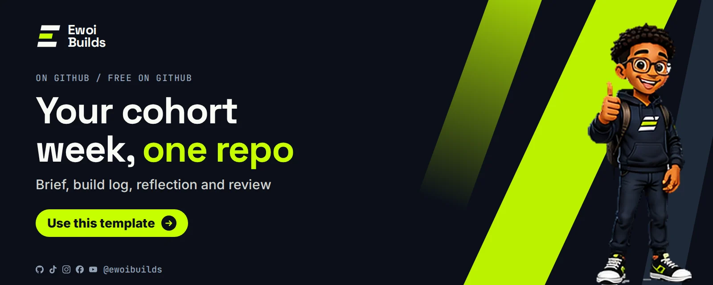

<!-- ewoi:top -->
<p align="center"></p>

<p align="center">
  <a href="https://github.com/ewoibuilds/cohort-week-template/generate"><b>Use this template &rarr;</b></a> &nbsp;&middot;&nbsp;
  <a href="https://github.com/ewoibuilds"><b>All free repos</b></a> &nbsp;&middot;&nbsp;
  <a href="https://www.youtube.com/@ewoibuilds"><b>Watch the lessons</b></a>
</p>

<p align="center">
  
  
  
</p>
<!-- /ewoi:top -->

# Cohort week: YOUR PROJECT TITLE

**Learn. Build. Ship.** Your project for one week of an Ewoi Builds evening cohort.

> Replace the title above, then fill in [WEEK.md](WEEK.md) on day one.

## Start here (5 minutes)

1. On this page, press **Use this template**, then **Create a new repository**.
2. Owner: **ewoibuilds**. Name it exactly:

   ```
   <cohort-slug>-<your-github-username>-week-<n>
   ```

   For example `evening-cohort-1-janedoe-week-1`. Keep it **Public** so your mentor and classmates
   can review it, and so it counts on your GitHub profile.
3. Clone it to your learning workspace:

   ```bash
   cd ~/ewoi-learning
   git clone https://github.com/ewoibuilds/evening-cohort-1-janedoe-week-1.git
   cd evening-cohort-1-janedoe-week-1
   ```

4. Copy the week's brief from the cohort class into [WEEK.md](WEEK.md), commit and push:

   ```bash
   git add WEEK.md
   git commit -m "docs: week brief"
   git push
   ```

5. Paste the repository link on your cohort page (Dashboard, Cohort, Submit a week's project).

## Your week, day by day

| When | Do this | File |
|---|---|---|
| Day 1 | Copy the brief and the "done when" list | [WEEK.md](WEEK.md) |
| Every evening | Build a small piece, commit it, write three lines | [LOG.md](LOG.md) |
| Stuck for 30 minutes | Open an issue with the **I am stuck** form, then ask in the cohort channel | Issues tab |
| Last day | Tick the checklist, record a short demo, write your reflection | [REFLECTION.md](REFLECTION.md) |
| Last day | Open a pull request from your `week` branch so your mentor can review | Pull requests |

## How to work (the habits that get you hired)

- **Commit small and often.** One idea per commit, with a clear message: `feat: add task form`,
  `fix: show error when title is empty`, `docs: add setup steps`.
- **Work on a branch.** `git switch -c week`, push it with `git push -u origin week`, and open a
  pull request into `main` at the end of the week.
- **Your code goes in [`src/`](src/).** Add a short "How to run it" section to this README once it
  runs.
- **Never commit secrets.** Keep passwords and keys in `.env` (already ignored by Git) and commit
  `.env.example` with placeholders like `changeme`.

## Check it is done

- [ ] WEEK.md has the brief and the "done when" list
- [ ] LOG.md has an entry for every class evening
- [ ] The project runs from a fresh clone by following this README
- [ ] REFLECTION.md is filled in
- [ ] A pull request is open for review
- [ ] The link is submitted on your cohort page

## Troubleshooting

| Problem | Fix |
|---|---|
| "Use this template" is missing | You are not signed in, or you have not accepted the organisation invitation yet: check the email from GitHub. |
| `Permission denied (publickey)` | Clone with the HTTPS link instead, or set up an SSH key (see [GitHub's guide](https://docs.github.com/en/authentication/connecting-to-github-with-ssh)). |
| Push asks for a password | GitHub needs a personal access token, not your account password, over HTTPS. |
| You committed a secret by mistake | Change the secret (make a new one) first, then remove it from the code. Deleting the commit is not enough. |

## Using AI this week

Understand the brief first, then ask for small steps and check every answer:

> I am a beginner in an evening coding cohort. This week's brief is: [paste WEEK.md]. My stack is
> [stack and versions]. I ran [command] and saw [output]. Explain in simple words what is wrong
> and give me a hint, not the full answer.

## Licence

MIT, see [LICENSE](LICENSE).

<!-- ewoi:end -->
## Keep going

- **Star this repo** so you can find it again, and so more learners discover it.
- **Follow [Ewoi Builds on GitHub](https://github.com/ewoibuilds)** to get the next steps and projects as they land.
- **Build it, then show it:** push your version to your own GitHub and share the link with us.
- **Stuck?** Open an issue with the "I am stuck" form. Say which step, what you ran and what you saw.
- **Lessons stay free.** If this helped, you can say thanks with [Buy me a soda](https://buymesoda.com/Rd3JwfQpNGaUXdyc4ImyIrXrENu2) or [Buy me a coffee](https://buymeacoffee.com/ewoibuilds).

Follow along: [GitHub](https://github.com/ewoibuilds), [TikTok](https://www.tiktok.com/@ewoibuilds), [Instagram](https://www.instagram.com/ewoibuilds/), [Facebook](https://www.facebook.com/profile.php?id=61596671420317), [YouTube](https://www.youtube.com/@ewoibuilds).

**Learn. Build. Ship.**
<!-- /ewoi:end -->
